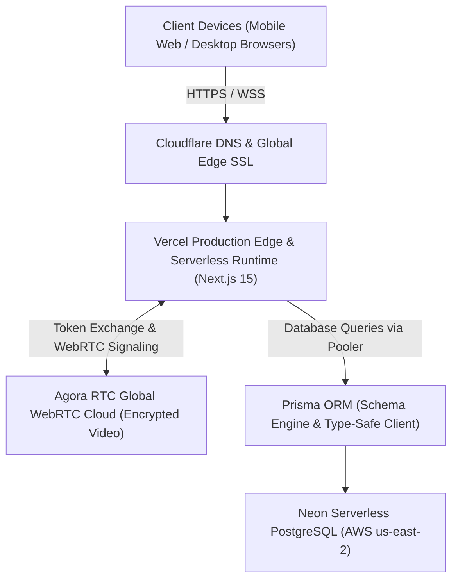
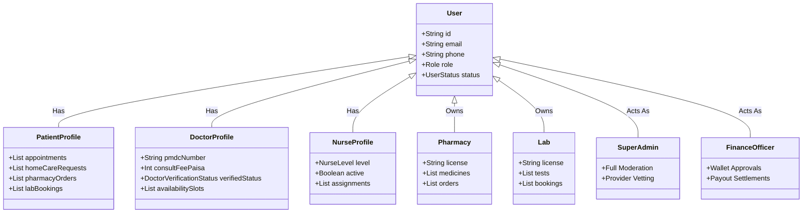
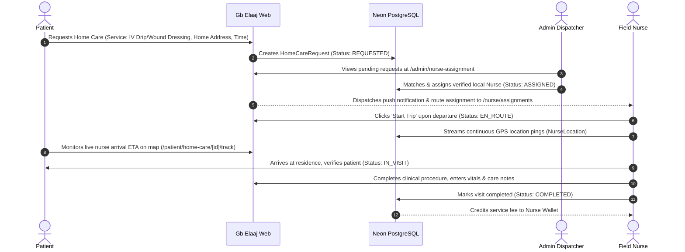
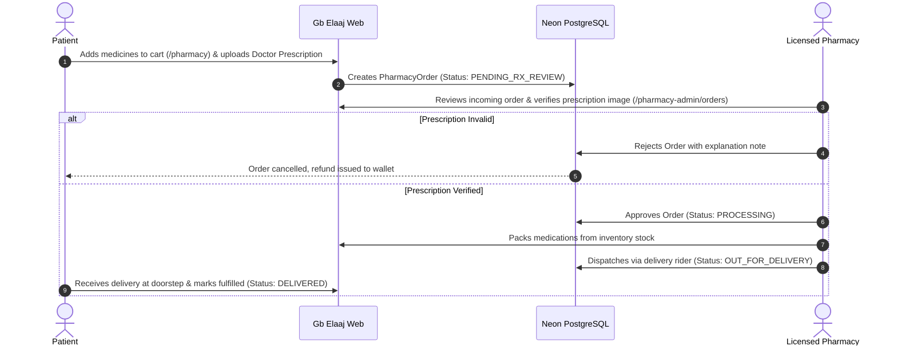
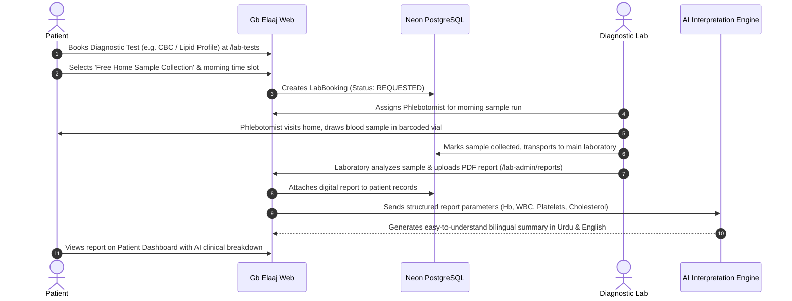

# Gb Elaaj (Care for All) — Master System Documentation

> **Platform Overview:** Comprehensive Digital Healthcare & Telemedicine Ecosystem connecting Gilgit-Baltistan and remote valleys across Pakistan with PMDC-certified doctors, verified nurses, licensed pharmacies, and accredited diagnostic laboratories.

---

## 1. Executive Summary

**Gb Elaaj** (`www.gbelaaj.com`) is a full-stack digital health platform engineered to bridge acute healthcare accessibility gaps in Gilgit-Baltistan and surrounding high-altitude regions. Due to extreme topography, harsh winters, and severe shortages of specialized medical personnel in mountainous valleys, residents frequently travel 12–24 hours to major urban centers (Islamabad, Rawalpindi, Gilgit) for routine specialist consultations, medication refills, or diagnostic follow-ups.

The platform provides a decentralized, 4-pillar healthcare infrastructure:
1. **Telemedicine Consultations:** Encrypted, in-browser HD video consultations with PMDC-verified specialists alongside digital prescription issuance.
2. **Home Healthcare & Nursing:** Dispatch-based nursing care with real-time GPS tracking for post-surgical care, wound dressing, and IV therapy at the patient's doorstep.
3. **E-Pharmacy Network:** Catalog-driven medicine procurement from licensed drug stores with mandatory prescription vetting for controlled pharmaceuticals.
4. **Doorstep Diagnostics:** Home sample collection by trained phlebotomists, rapid digital report delivery, and automated AI-driven clinical interpretation.

---

## 2. Technology Stack & Infrastructure Architecture



### Core Technologies

| Layer | Technology | Version | Purpose |
| :--- | :--- | :--- | :--- |
| **Framework** | Next.js (App Router, React Server Components) | `15.5.15` | Hybrid SSR, SSG, and Server Actions architecture |
| **Core UI** | React / React DOM | `19.0.0` | Concurrent UI rendering, Transitions, and Client Components |
| **Language** | TypeScript | `5.7.2` | Strict end-to-end type safety with zero runtime type leaks |
| **Styling** | Tailwind CSS & Framer Motion | `3.4.17` / `11.15.0` | Medical-grade responsive tokens, accessible components |
| **Database** | Neon Cloud PostgreSQL | Serverless v16 | Scalable cloud PostgreSQL with connection pooling |
| **ORM** | Prisma ORM | `5.22.0` | Declarative schema modeling, automated migrations, type safety |
| **Authentication** | Auth.js / NextAuth (Credentials Provider) | `5.0.0-beta.25` | Session JWTs, role-based route middleware, RBAC enforcement |
| **Video Engine** | Agora RTC WebRTC SDK | `4.24.3` | Ultra-low latency encrypted browser video calling |
| **Validation** | Zod | `3.24.1` | Client- and server-side input schema validation |
| **Hosting & DNS** | Vercel Edge Network + Cloudflare DNS | Live | Automatic CI/CD continuous deployment, global TLS termination |

---

## 3. Role-Based Access Control (RBAC) Matrix

Gb Elaaj partitions platform access into **7 strictly isolated user roles**:



### Role Capabilities & Portals

| Role | Portal Route | Registration Path | Verification Policy | Key Responsibilities |
| :--- | :--- | :--- | :--- | :--- |
| **PATIENT** | `/patient/dashboard` | `/signup` (Self-service) | Instant Activation (`ACTIVE`) | Booking doctors, requesting home care nurses, ordering medicines, downloading lab reports |
| **DOCTOR** | `/doctor/dashboard` | `/signup` (Provider Tab) | Mandatory PMDC Review (`PENDING_VERIFICATION`) | Managing clinical schedule, conducting video calls, issuing digital prescriptions, viewing patient histories |
| **NURSE** | `/nurse/dashboard` | `/signup` (Provider Tab) | Mandatory PNC/CNIC Review (`PENDING_VERIFICATION`) | Receiving home dispatch orders, streaming live GPS arrival coordinates, administering bedside care |
| **PHARMACY** | `/pharmacy-admin` | `/signup` (Provider Tab) | Drug Sale License (DSL) Review (`PENDING_VERIFICATION`) | Inventory catalog management, reviewing doctor prescriptions, dispatching medicine orders |
| **LAB** | `/lab-admin` | `/signup` (Provider Tab) | Clinical Commission Review (`PENDING_VERIFICATION`) | Test catalog maintenance, phlebotomy scheduling, PDF lab report upload, result entry |
| **ADMIN** | `/admin/dashboard` | System Managed / Invite Only | Direct Provisioning (`ACTIVE`) | Approving provider licenses, overseeing system operations, managing platform users |
| **FINANCE** | `/finance` | System Managed / Invite Only | Direct Provisioning (`ACTIVE`) | Doctor consultation fee settlements, nurse service fee payouts, platform commissions |

---

## 4. End-to-End System Workflows

### 4.1 Telemedicine Workflow (Doctor & Patient)

```mermaid
sequenceDiagram
    autonumber
    actor P as Patient
    participant Web as Gb Elaaj Web
    participant DB as Neon PostgreSQL
    actor D as Doctor
    actor A as Super Admin

    Note over D,A: Phase 1: Onboarding & Vetting
    D->>Web: Submits Signup with PMDC, Qualifications, Fees
    Web->>DB: Saves DoctorProfile (Status: PENDING_VERIFICATION)
    A->>Web: Reviews PMDC credential at /admin/doctor-verification
    A->>DB: Approves DoctorProfile (Status: APPROVED)
    D->>Web: Generates 20-min slots at /doctor/schedule
    Web->>DB: Inserts DoctorAvailability slots (Status: OPEN)

    Note over P,D: Phase 2: Consultation Booking
    P->>Web: Searches doctor by specialty/city at /doctors
    P->>Web: Selects Date/Time slot & enters symptoms
    P->>DB: Creates Appointment (Status: PENDING) & reserves slot
    Web-->>D: Sends appointment notification to Doctor Queue

    Note over P,D: Phase 3: Video Consultation & Prescription
    P->>Web: Joins Video Room at scheduled time (/patient/appointments/[id]/video)
    D->>Web: Joins Video Room (/doctor/video-room/[appointmentId])
    Web<-->>Web: Agora WebRTC Media Stream connects Doctor & Patient
    D->>Web: Fills Digital Rx (Medicines, dosage, duration, lab tests)
    D->>DB: Signs & submits Prescription (Creates MedicalRecord)
    DB-->>P: Prescription available for download (PDF) or Pharmacy dispatch
```

---

### 4.2 Home Nursing Care Dispatch Workflow



---

### 4.3 E-Pharmacy & Prescription Fulfillment Workflow



---

### 4.4 Diagnostic Lab & AI Report Interpretation Workflow



---

## 5. Live Production Credentials & Environments

> [!IMPORTANT]
> The database connection is hosted on Neon Serverless Cloud. All passwords below are active in the live environment and should be safeguarded according to HIPAA/GDPR health data protection guidelines.

### Production Endpoints

| Platform Service | Live URL | Hosting Provider |
| :--- | :--- | :--- |
| **Primary Domain** | `https://www.gbelaaj.com` | Cloudflare DNS + Vercel Edge |
| **Vercel Mirror** | `https://gb-elaaj.vercel.app` | Vercel Cloud |
| **System Health Check** | `https://www.gbelaaj.com/api/health` | Vercel Edge Serverless |

### Master Credentials Directory

| Role / Entity | Email / Identifier | Password | Access Scope |
| :--- | :--- | :--- | :--- |
| **Super Admin** | `admin@gbelaaj.pk` | `admin1234` | Full platform administration, doctor/nurse verification, audit logs |
| **Finance Officer** | `finance@gbelaaj.pk` | `finance1234` | Financial ledger, doctor/nurse payout requests, commission splits |
| **Verified Doctors (12 Accounts)** | Listed in Desktop Excel | `Doctor1234!` | Clinical dashboard, appointments, schedule editor, e-prescriptions |
| **Verified Nurses (12 Accounts)** | Listed in Desktop Excel | `Nurse1234!` | Field nursing assignments, patient dispatch, GPS tracking portal |
| **Desktop Master Spreadsheet** | `C:\Users\Rc\Desktop\Gb_Elaaj_Complete_Staff_and_Logins.xlsx` | — | Contains 3 formatted sheets: Doctors, Nurses, and System Logins |

---

## 6. Database Architecture & Key Models

### Core Prisma Entities

```prisma
// Core Identity
model User {
  id            String     @id @default(cuid())
  name          String
  email         String?    @unique
  phone         String?    @unique
  passwordHash  String?
  role          Role       @default(PATIENT)
  status        UserStatus @default(ACTIVE)
  emailVerified DateTime?
  // Relations: doctor, patient, nurseProfile, pharmacyAdmin, labAdmin
}

// Telemedicine
model DoctorProfile {
  id              String         @id @default(cuid())
  userId          String         @unique
  pmdcNumber      String         @unique
  qualifications  String
  consultFeePaisa Int
  clinicFeePaisa  Int
  verifiedStatus  DoctorVerificationStatus @default(PENDING)
  availability    DoctorAvailability[]
  appointments    Appointment[]
}

model DoctorAvailability {
  id          String       @id @default(cuid())
  doctorId    String
  startsAt    DateTime
  endsAt      DateTime
  mode        ConsultMode  // VIDEO | CLINIC
  status      SlotStatus   // OPEN | BOOKED | BLOCKED
}

model Appointment {
  id           String            @id @default(cuid())
  patientId    String
  doctorId     String
  mode         ConsultMode
  status       AppointmentStatus // PENDING | CONFIRMED | COMPLETED | CANCELLED
  feePaisa     Int
  scheduledFor DateTime
  records      MedicalRecord[]
}

// Home Nursing
model HomeCareRequest {
  id           String         @id @default(cuid())
  patientId    String
  nurseId      String?
  serviceName  String
  status       HomeCareStatus // REQUESTED | ASSIGNED | EN_ROUTE | IN_VISIT | COMPLETED
  scheduledFor DateTime
  addressLine  String
  pricePaisa   Int
  locations    NurseLocation[]
}

// Pharmacy & Labs
model Medicine {
  id           String   @id @default(cuid())
  pharmacyId   String
  nameGeneric  String
  nameBrand    String?
  stock        Int
  pricePaisa   Int
  rxRequired   Boolean  @default(false)
}

model LabTest {
  id              String  @id @default(cuid())
  labId           String
  nameEn          String
  pricePaisa      Int
  homeEligible    Boolean @default(true)
  fastingRequired Boolean @default(false)
}
```

---

## 7. Operations, Deployment & Maintenance

### 7.1 Continuous Deployment (CI/CD) Workflow
- Production repository: `https://github.com/Sir-Sadaqat-Ali/gb-elaaj.git` on branch `main`.
- Vercel is connected natively via Git integration.
- Every commit pushed to `main` automatically triggers an edge build, runs schema validation, and deploys with zero downtime.
- Redundant and failing GitHub Actions triggers have been streamlined to prevent false alarm notification emails.

### 7.2 Generating Future Doctor Availability Slots
Doctors can generate additional slots via their `/doctor/schedule` dashboard, or administrators can run programmatic slot generation against Neon DB to extend slots across upcoming months.

### 7.3 Security Best Practices
- Passwords are encrypted with `bcrypt` (12 rounds).
- Protected API routes enforce session token checks and reject unauthorized role requests with HTTP 403 Forbidden.
- Unvetted medical providers are held in `PENDING_VERIFICATION` status until physical license verification is completed by the administrative review board.
